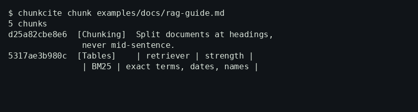

# chunkcite

[](https://github.com/hydope/chunkcite/actions/workflows/ci.yml)

**Structure-aware chunking for RAG, with citations you can actually verify — no LLM judge, no API key, no network.**

Most RAG answers cite chunks that were split mid-sentence, with tables
shattered across embeddings and no page or section to trace back to.
chunkcite chunks at headings, keeps tables whole, stamps every chunk
with a heading path and line range, then checks each claim against its
cited chunk — and flags the invented ones.



## 30-second quickstart

```bash
python3 -m venv .venv && . .venv/bin/activate
pip install -e .
chunkcite chunk examples/docs/rag-guide.md --out chunks.jsonl
chunkcite eval --chunks chunks.jsonl --golden examples/golden.jsonl
chunkcite verify --chunks chunks.jsonl --claims examples/claims.json
```

Expected output on the shipped synthetic example:

```json
{ "cases": 4, "k": 5, "recall@5": 1.0, "mrr": 1.0 }
```

and for verify: `2/3 claims supported` — the invented
"99 percent faster" claim is flagged `unsupported` with overlap 0.125.

PDF input is optional: `pip install "chunkcite[pdf]"`, then chunk a
`.pdf` the same way; page numbers are kept on each chunk and surfaced
by `chunkcite audit` (`pages`, `chunks_by_page`). DOCX works the same
way with `pip install "chunkcite[docx]"` — headings and tables are
preserved in document order.

## What it does

- `chunkcite chunk` — Markdown / text / PDF → JSONL chunks with stable
  ids (`sha1(source + locator + text)[:12]`), heading path, line range,
  page (PDF), and kind (`paragraph` / `table`).
- `chunkcite verify` — a claim is `supported` only if its cited chunk
  contains it verbatim or with token overlap ≥ 0.6. Unknown chunk ids
  are `unresolved`, not silently passed. Exit code 1 if any claim fails,
  so it can gate CI.
- `chunkcite eval` — recall@k and MRR over a golden set, using a
  standard-library BM25-style scorer. No embeddings, no judge model,
  so the numbers reproduce on any machine.
- `chunkcite audit` — flags orphan chunks, oversized chunks, and
  duplicate text before you index 10,000 documents, and reports
  which pages your chunks came from.
- Optional Gemini / Vertex adapter (`chunkcite.adapters.gemini`,
  not imported by the core) — feed chunks to your own model
  callable, parse its `[chunk_id]` citations, and verify every claim
  offline. No Google dependency, no API key read by this code.

## Benchmarks I actually ran

Method: `python benchmarks/benchmark.py` — same scorer, same corpus
(`examples/docs/rag-guide.md`, synthetic, shipped in the repo), two
chunkers: chunkcite vs a fixed-size 500-char splitter implemented in
the benchmark script. Full output in `benchmarks/results.json`.

| | chunkcite | fixed 500-char |
|---|---|---|
| recall@5 (4 questions) | 1.0 | 1.0 |
| MRR | 1.0 | 1.0 |
| chunks | 5 | 2 |
| chunks with heading path | 5 / 5 | 0 / 2 |
| table kept as a standalone chunk | yes | no |
| chunks ending mid-sentence | 0 | 1 |

Honest reading: recall is **tied** on this tiny 4-question set — that
set is too small to separate retrievers, and I won't claim otherwise.
The difference is structural: fixed chunking loses the heading path,
merges the table into surrounding prose, and splits a sentence. On a
larger, real corpus those structural losses are where citations go
wrong. A larger benchmark with real documents is on the roadmap, not
in this README as a claim.

## Comparison

| Tool | Stars (GitHub API, 2026-10-24) | License | What it is |
|---|---|---|---|
| [LlamaIndex](https://github.com/run-llama/llama_index) | 52,641 | MIT | Full RAG framework, incl. evals |
| [Langfuse](https://github.com/langfuse/langfuse) | 36,301 | see repo | Tracing + evals platform |
| [promptfoo](https://github.com/promptfoo/promptfoo) | 26,367 | MIT | Declarative LLM eval / red-teaming |
| [DeepEval](https://github.com/confident-ai/deepeval) | 19,075 | Apache-2.0 | Pytest-style LLM evals |
| [Ragas](https://github.com/vibrantlabsai/ragas) | 16,138 | Apache-2.0 | RAG metrics, LLM-as-judge |
| [Tracely-ai](https://github.com/jwuthri-cloud/Tracely-ai) | 1,165 | MIT | Trace-native CI/CD for agents |
| **chunkcite (this repo)** | 0 (new) | MIT | Offline chunking + citation verification + no-LLM eval |

Gap vs those tools: none of them make *chunking itself* the
verifiable unit — heading path + locator on every chunk, table
integrity, and a claim check that needs no judge model and no API
key. chunkcite is deliberately small: it does not try to be a
framework, a tracing platform, or a hosted eval service.

## Prior art and credits

Structure-aware chunking, citation grounding, and RAG evaluation are
well-established ideas. chunkcite's implementation is original code,
written for this repo, but it stands on: Ragas / DeepEval / promptfoo
for the eval vocabulary (recall, faithfulness-style checking),
LlamaIndex for chunking practice, and the BM25 ranking idea from
classic information retrieval. No code was copied from those projects.
All example documents in this repo are synthetic.

## Roadmap

- [ ] Larger benchmark on real public documents (not just the synthetic guide)
- [x] `.docx` input (`chunkcite[docx]`)
- [ ] `--threshold` flag on `verify` — in progress with a community contributor (see issue #3)
- [x] Optional Gemini / Vertex adapter — outside the offline core, never required for tests
- [ ] pgvector export: chunk JSONL → SQL with `vector` column

## License

MIT — see `LICENSE`. Contributions welcome; see `CONTRIBUTING.md`.
